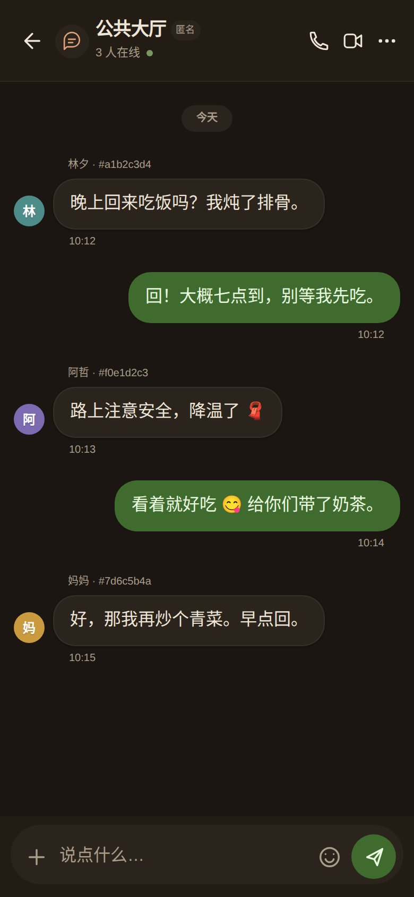
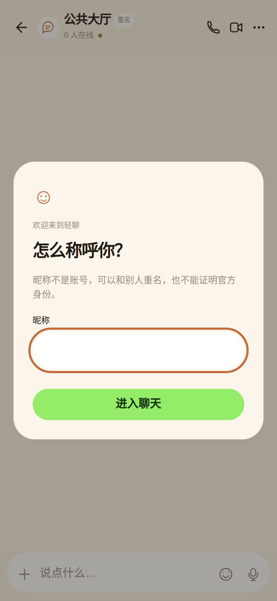
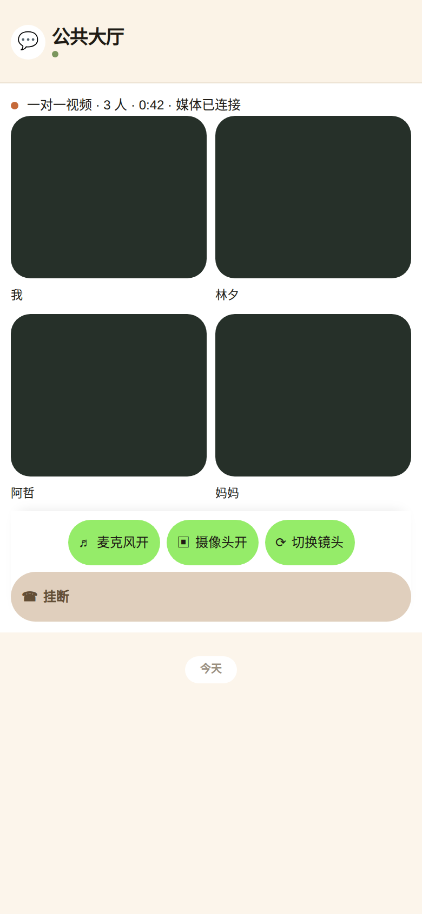
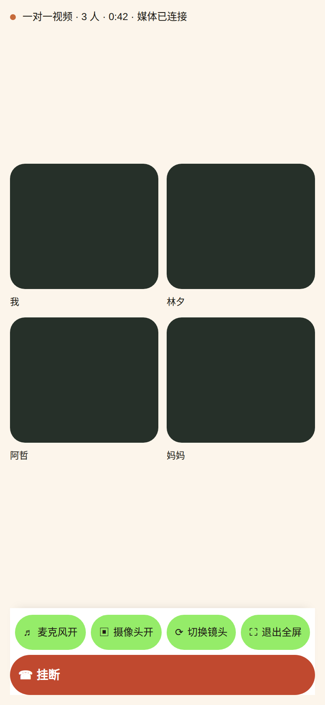
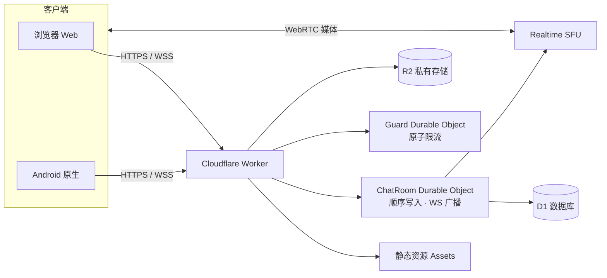

<div align="center">

# 轻聊 · Qingliao

**登录即用的匿名聊天室 —— 文字、图片、语音、文件与实时音视频，全部跑在 Cloudflare 边缘。**

[](https://workers.cloudflare.com/)
[](https://www.typescriptlang.org/)
[](#-客户端)
[](https://developers.cloudflare.com/realtime/)
[](#-状态与限制)
[](#-许可)




</div>

---

## 目录

- [简介](#-简介)
- [功能特性](#-功能特性)
- [界面预览](#-界面预览)
- [架构](#-架构)
- [技术栈](#-技术栈)
- [快速开始](#-快速开始)
- [部署到 Cloudflare](#-部署到-cloudflare)
- [配置项](#-配置项)
- [安全与隐私](#-安全与隐私)
- [Android 客户端](#-客户端)
- [目录结构](#-目录结构)
- [文档](#-文档)
- [状态与限制](#-状态与限制)
- [Roadmap](#-roadmap)
- [贡献](#-贡献)
- [许可](#-许可)

---

## 简介

**轻聊（Qingliao）** 是一个免注册的匿名聊天室。打开网页即可进入公共大厅或凭口令进入私人房间，进行文字、图片、语音、视频、文件消息与实时音视频通话。

它是一套完整的全栈产品，而非静态演示：

- **服务端**是一个部署在 Cloudflare 边缘的 TypeScript Worker，页面与 API 同源；
- **实时链路**由 Durable Object（房间顺序写入 + WebSocket Hibernation）承担；
- **数据**落在 D1（房间 / 消息 / 匿名会话 / 通话记录）、**私有** R2（媒体）与 **Cloudflare Realtime SFU**（音视频转发）；
- **客户端**既有优先移动端的 Web 前端，也有一个原生 Android 客户端（非 WebView 套壳）。

> 演示站点：<https://chat.lyrnox.com>（隔离测试 Worker，可能重置）

---

## ✨ 功能特性

**聊天与房间**
- 免注册匿名进入；昵称可重名，用会话短码区分
- 公共大厅 + 私人房间（口令进入，PBKDF2-SHA256 + 每房随机盐）
- 房间号可直接分享复制，旧链接 / UUID 房号保持兼容
- WebSocket 实时收发、在线成员、未读提示、历史消息游标分页
- 消息分组、日期分隔、引用回复、复制与撤回（删除自己的消息）

**富媒体**
- 文本（4000 字）、图片、语音录制、视频、普通文件
- 分类型大小限制；上传授权 → 确认 → 私有 R2 存储 → 短票据授权下载
- 图片灯箱预览、视频内联 / 全屏播放、音频进度播放

**实时音视频**
- 基于 Cloudflare Realtime SFU / WebRTC 的语音与视频通话
- 一对一呼叫与多人通话，接听 / 拒绝 / 静音 / 关闭摄像头 / 切换镜头 / 音频路由
- 移动端优化：**通话控制条（含挂断）常驻可见**，支持**一键全屏看人**

**界面**
- 微信 / 聊记风格：暖米色底、绿色发出气泡、白底描边收到气泡、彩色头像
- 自动深色模式；现代无障碍语义与键盘操作

**安全**
- 列级参数化 SQL、CSP、CSRF（Origin + `SameSite=Strict`）、HMAC 下载票据
- 服务端原子限流（Durable Object）、私有 R2、SFU Secret 永不下发

---

## 界面预览

| 进入 / 昵称 | 聊天（浅色） | 聊天（深色） |
|:---:|:---:|:---:|
|  |  |  |

| 通话控制条（挂断常驻） | 通话全屏 |
|:---:|:---:|
|  |  |

---

## 架构



| 组件 | 职责 |
|---|---|
| **Worker** | 同源提供页面与 API；会话、房间、上传授权、受保护下载、定时清理 |
| **ChatRoom (DO)** | 单房间权威写入与广播，WebSocket Hibernation，历史 / 成员 / 通话状态 |
| **Guard (DO)** | 跨请求的原子固定窗口限流（可跨休眠恢复） |
| **D1** | 房间、消息、匿名会话、上传、通话与限流记录 |
| **R2** | 私有媒体对象（staging → media，从不对外暴露裸链接） |
| **Realtime SFU** | 语音 / 视频发布订阅与轨道转发；TURN 可按需配置 |

---

## 🧱 技术栈

- **运行时**：Cloudflare Workers · Durable Objects（SQLite）· D1 · R2 · Cron Triggers
- **服务端**：TypeScript，WebCrypto（PBKDF2 / HMAC / SHA-256），`aws4fetch` 签名 R2 直传
- **前端**：原生 HTML / CSS / JavaScript（无框架），WebSocket、MediaRecorder、WebRTC
- **实时媒体**：Cloudflare Realtime SFU（发布 / 订阅 / 协商 / 租约）
- **Android**：原生 Java + JNI/C++ 引擎 + OkHttp + WebRTC SDK（非 WebView）

---

## 🚀 快速开始

需要 **Node ≥ 22**、**pnpm 10**（`corepack enable` 后 `corepack prepare pnpm@10.32.1 --activate`）。

```bash
# 1) 安装依赖
pnpm install --frozen-lockfile

# 2) 本地环境变量（DEV_LOCAL=true，APP_SECRET 至少 32 位随机）
cp .dev.vars.example .dev.vars
#   APP_SECRET 可用：openssl rand -hex 32

# 3) 初始化本地数据库
pnpm db:local

# 4) 启动开发服务器
pnpm dev
# 打开 http://localhost:8787 ，另开无痕窗口作为第二个人
```

常用脚本：

```bash
pnpm typecheck     # 类型检查
pnpm test          # 本地集成 + SFU 契约测试
pnpm check         # 类型 + 测试 + JS 语法 + 打包预演
pnpm test:remote   # 双浏览器线上验收（会写入隔离测试 D1）
```

---

## ☁️ 部署到 Cloudflare

```bash
# 一次性初始化（会创建/修改你的 Cloudflare 资源）
pnpm exec wrangler login
pnpm exec wrangler d1 create chat
pnpm exec wrangler r2 bucket create anonymous-chat-media
# 将返回的 database_id 填入 wrangler.jsonc 的 d1_databases[0]

# 应用迁移 + 设置密钥
pnpm exec wrangler d1 migrations apply chat --remote
pnpm exec wrangler secret put APP_SECRET
# 可选：R2 S3 直传凭据 / SFU / TURN
pnpm exec wrangler secret put SFU_APP_ID
pnpm exec wrangler secret put SFU_APP_SECRET

# 部署
pnpm typecheck
pnpm exec wrangler deploy --dry-run --outdir .build
pnpm exec wrangler deploy
```

R2 保持私有；如需浏览器直传，按 `r2-cors.example.json` 配置 CORS（用你的真实站点源，不要用 `*`）。自定义域名在 Worker → Settings → Domains & Routes 绑定，并同步更新 CORS。

---

## ⚙️ 配置项

| 名称 | 类型 | 说明 |
|---|---|---|
| `APP_SECRET` | Secret | ≥32 位随机串，用于 HMAC 签名（下载票据等） |
| `DEV_LOCAL` | Var | 本地开发置 `true`；生产必须为 `false` |
| `R2_BUCKET` | Var | R2 桶名 |
| `R2_ACCOUNT_ID` / `R2_ACCESS_KEY_ID` / `R2_SECRET_ACCESS_KEY` | Var / Secret | 可选；配置后启用 S3 预签名直传，否则走同源 Worker 流式上传 |
| `SFU_APP_ID` / `SFU_APP_SECRET` | Secret | Cloudflare Realtime SFU；缺省时音视频接口返回 503，文字不受影响 |
| `TURN_KEY_ID` / `TURN_API_TOKEN` | Secret | 可选，限制性网络下的 TURN 中继 |
| `SFU_DIAGNOSTICS` | Var | 置 `true` 时向客户端返回脱敏的 SFU 诊断 |

各项限额集中在 [`src/shared.ts`](src/shared.ts) 的 `LIMITS`：文本 4000 字符、昵称 32、图片/语音 10 MiB、视频 100 MiB、普通文件 50 MiB、单房 8 人。

---

## 🔐 安全与隐私

- **会话**：服务端随机 token，数据库仅存 SHA-256；`HttpOnly`、生产 `Secure`、`SameSite=Strict`、7 天过期。
- **口令**：PBKDF2-SHA256、每房随机盐、常量时间比较；创建口令 ≥ 8 位；按 IP / 会话限速尝试。
- **CSRF / 同源**：非 GET 请求校验 `Origin`，配合 `SameSite=Strict`。
- **下载**：绑定会话/房间/消息的 HMAC 短票据（60s），强制 `attachment` + `nosniff`，不给客户端裸 R2 链接。
- **上传**：先按申报大小/类型授权，确认时再校验实际 R2 对象大小与类型，最终写入不可覆盖的 key。
- **限流**：Durable Object 原子固定窗口；会话/消息/上传/通话/口令尝试均限速。
- **响应头**：CSP、`X-Content-Type-Options: nosniff`、`Referrer-Policy: no-referrer`、`Permissions-Policy`。
- **隐私**：无 E2EE，服务端会处理并保存聊天记录与通话元数据（不保存通话媒体）。详见 [安全说明](#-状态与限制)。

> 发现安全问题请勿公开提交 Issue，见 [SECURITY.md](SECURITY.md)。

---

## 📱 客户端

**Android**：原生客户端，直连本仓库的 Cloudflare 服务（非 WebView 套壳），UI 与网页同为微信 / 聊记风格。

- 最新正式版（release 签名）：见 **[GitHub Releases](https://github.com/lyrnoxfan/cloudflare-anon-chat/releases)**
- 源码：[`android/`](android/)，构建需 JDK 17、Android SDK 35、NDK 27.2、CMake 3.22
- CI 通过 `.github/workflows/qingliao-android-sign-polish.yml` 构建并用发布证书签名

```bash
cd android
./gradlew assembleDebug   # 本地调试包
```

---

## 📂 目录结构

```
src/            Worker：路由/会话/房间/上传签名/下载/清理/Guard
  index.ts      HTTP 入口与资源、上传授权、受保护下载
  room.ts       ChatRoom Durable Object：顺序写入、历史、WS 广播
  sfu.ts        Realtime SFU 适配：参会授权、轨道、租约与清理
  shared.ts     限额、校验、口令哈希、HMAC、DB 授权
public/         原生 HTML/CSS/JS 前端（聊天、通话、表情）
migrations/     D1 schema 与固定公共大厅
android/        原生 Android 客户端（Java + JNI/C++ + WebRTC）
docs/           验收、部署状态、审查记录与截图
tests/          可复现集成 / SFU 契约 / 远程测试
wrangler.jsonc            生产配置
wrangler.test.jsonc       隔离测试 Worker 配置
```

---

## 📝 文档

| 文档 | 内容 |
|---|---|
| [docs/DEPLOYMENT_STATUS.md](docs/DEPLOYMENT_STATUS.md) | 部署状态与验收记录 |
| [docs/ACCEPTANCE.md](docs/ACCEPTANCE.md) | 验收清单 |
| [docs/SOURCES.md](docs/SOURCES.md) | 官方 API / 价格依据与检索日期 |
| [docs/REVIEW-2026-11-28.md](docs/REVIEW-2026-11-28.md) | 安全审查与改动记录 |
| [android/README.md](android/README.md) | Android 客户端架构与构建 |
| [SECURITY.md](SECURITY.md) · [CONTRIBUTING.md](CONTRIBUTING.md) | 安全策略 · 贡献指南 |

---

## 📊 状态与限制

本项目在本地模拟器（Wrangler/D1/R2/DO + Chromium 双会话）与隔离测试 Worker 上通过了真实收发、幂等、私人房间隔离、上传/下载、XSS 防护与策略校验。

以下仍以文档为准、尚需真机或生产环境验证，请不要把“本地/模拟通过”当作真机验收：

- 真机与弱网、TURN-only 网络下的音视频质量与音频路由
- 完整跨设备视觉对齐、多人通话的长时间稳定性
- 生产环境的 WAF / Turnstile、预算告警与滥用处置

详细的未验收项见 [docs/DEPLOYMENT_STATUS.md](docs/DEPLOYMENT_STATUS.md)。无 E2EE；媒体不做病毒扫描；文本与已确认媒体默认无自动 TTL。

---

## 🗺 Roadmap

- [x] 免注册匿名大厅 + 私人房间（口令）
- [x] 文字 / 图片 / 语音 / 视频 / 文件消息
- [x] 实时音视频通话（SFU）与移动端全屏 / 挂断常驻
- [x] 微信 / 聊记风格主题 + 深色模式
- [x] 原生 Android 客户端与 CI 签名发布
- [ ] 消息按“同人同天 5 分钟”合并、组尾时间/头像（进行中）
- [ ] 真机弱网与多人通话长时间稳定性验收
- [ ] WAF / Turnstile 与运营级滥用治理

---

## 🤝 贡献

欢迎 Issue 与 Pull Request。提交前请阅读 [CONTRIBUTING.md](CONTRIBUTING.md)，并确保 `pnpm check` 通过；涉及安全的改动请先在私下渠道沟通（见 [SECURITY.md](SECURITY.md)）。

---

## 📄 许可

本项目为**专有软件（Proprietary）**，版权归作者所有，未经授权不得复制、分发或商用。详见 [LICENSE](LICENSE)。

<div align="center"><sub>轻聊 · Qingliao — 让每一次匿名对话都轻快、干净、可靠。</sub></div>
